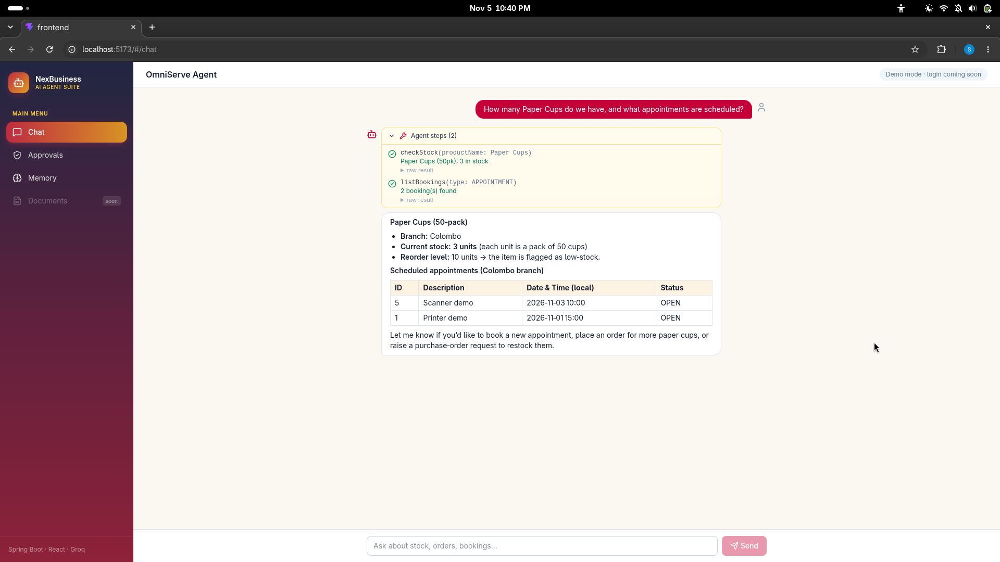
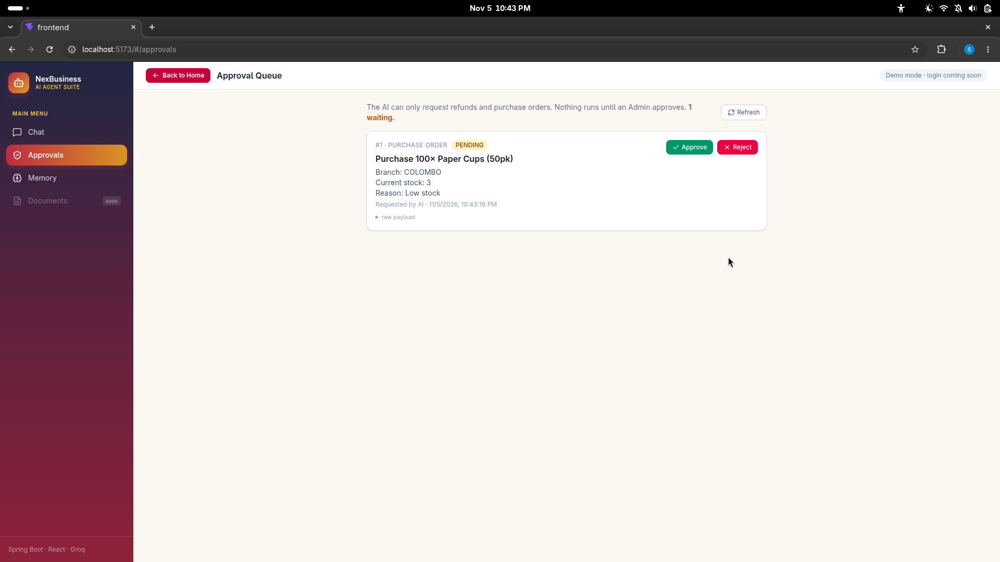
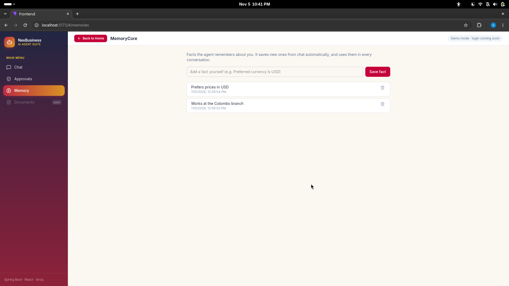
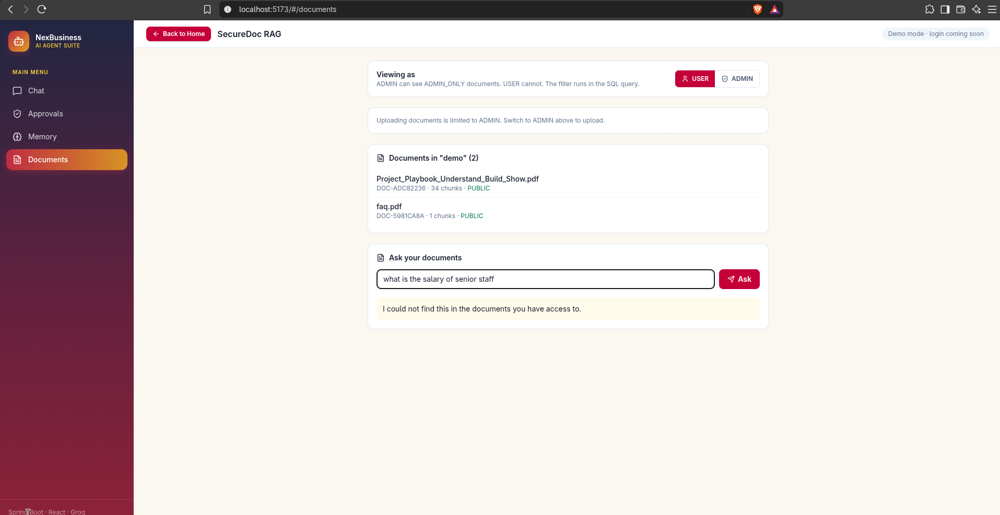
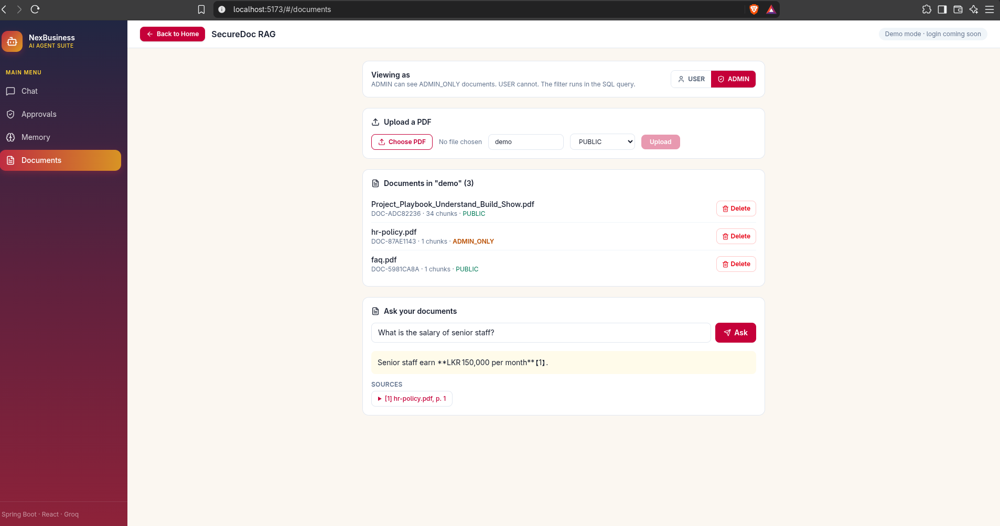
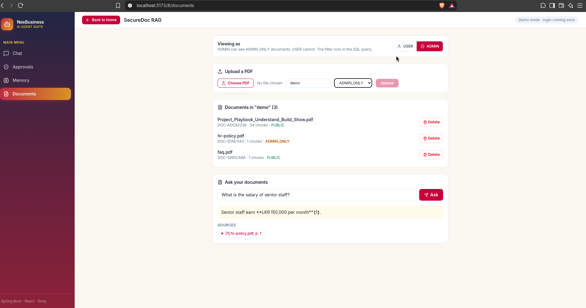

# NexBusiness Cloud

An AI agent and RAG platform for small businesses, built with Java Spring Boot, React (Vite + Tailwind CSS), MySQL, and the Groq API (Llama-3).

## Modules

1. **SecureDoc RAG Engine:** project-based document namespaces, role-based access (PUBLIC vs ADMIN_ONLY), and page-level citations.
2. **OmniServe Action Agent:** tool-calling agent for POS, CRM and ERP tasks (for example stock checks), with a manager approval queue for sensitive actions.
3. **MemoryCore Portal:** long-term user fact extraction and switchable LLM models.

## Quick start

1. Copy the example environment file and add your own Groq key:

        cp .env.example .env

2. Start everything:

        docker compose up -d

3. Try the agent (the backend listens on port 8081):

        curl -s -X POST http://localhost:8081/api/omniserve/chat \
          -H "Content-Type: application/json" \
          -d '{"message":"How many Paper Cups do we have?"}'

## Demo data

Reset the demo inventory (Paper Cups drops to 3 units so the reorder flow can be shown):

    docker compose exec -T mysql-db sh -c 'mysql -uroot -p"$MYSQL_ROOT_PASSWORD" nexbusiness_db' < scripts/demo-reset.sql

## Configuration

Secrets live in `.env`, which is never committed. See `.env.example` for the variables.

## Screenshots

### SecureDoc: same question, different answers by role

USER cannot see ADMIN_ONLY documents:

ADMIN gets the answer with a page-level citation:

Document list with delete (ADMIN only):

